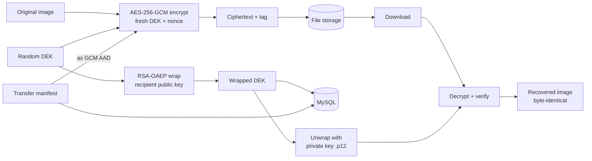

# Medical Image Encryption & Secure Sharing — Academic Report

## Abstract

Digital medical imaging is central to modern diagnostics, yet the transmission of
radiological images over hospital networks and between institutions raises serious
confidentiality and integrity concerns. This project presents the design and
implementation of a Java desktop application that encrypts medical images before
storage and transfer and releases them only to their intended recipient. Each transfer
is protected with AES-256-GCM under a fresh 256-bit data key and a unique 96-bit nonce;
the data key is wrapped individually for the recipient using RSA-2048 OAEP; recipients'
private keys are held in PKCS#12 keystores and never transmitted. The system follows a
three-role model (Administrator, Doctor, Specialist) with server-side role-based access
control, an append-only audit log, a MySQL 8.0 persistence layer accessed through JDBC,
and TCP socket services for key management and transfer. Implementation details,
security analysis and experimental validation — including byte-exact recovery and
tamper rejection — are reported. The system is an academic prototype and is explicitly
not production-ready.

**Keywords:** medical image security, AES-GCM, RSA-OAEP, PKCS#12, RBAC, secure file
transfer, JavaFX, MySQL.

## 1. Introduction

### 1.1 Background
Picture Archiving and Communication Systems move large volumes of sensitive images.
Regulatory frameworks (e.g. HIPAA, India's DPDP Act) require confidentiality, integrity
and accountability. Encryption at the application layer complements network security
and gives per-recipient access control.

### 1.2 Problem statement
Design and build a runnable client–server application in which a doctor can encrypt a
medical image and share it with a designated specialist so that (a) only that specialist
can decrypt it, (b) any modification of the ciphertext is detected, (c) all access is
authorized server-side and recorded, and (d) no plaintext key is ever stored.

### 1.3 Objectives
1. Encrypt images with a standard AEAD cipher using per-transfer keys and nonces.
2. Wrap keys per recipient so that compromise of one transfer does not expose others.
3. Enforce three-role permissions in the backend, not merely in the UI.
4. Persist users, keys, transfers and audit events in MySQL 8.0 via JDBC.
5. Transfer ciphertext over TCP sockets with a documented protocol.
6. Verify the complete workflow end-to-end, including negative cases.

## 2. Literature Review (summary)

* **AES-GCM** (NIST SP 800-38D) is the dominant AEAD construction; unique nonces are
  mandatory for security.
* **RSA-OAEP** (PKCS#1 v2.2) is the standard public-key wrap mechanism; SHA-256/SHA-1
  OAEP variants are supported by the JCE `SunJCE` provider.
* **PKCS#12** is the standard portable keystore format for private keys + certificates.
* Prior academic systems ("secure medical image sharing") commonly combine hybrid
  encryption (AES + RSA), hashing for integrity and RBAC — this project follows that
  consensus and focuses on an honest, fully working implementation with negative
  testing, rather than proposing a new cryptographic primitive.
* Standards/guidelines referenced: NIST SP 800-38D, NIST SP 800-57 (key management),
  OWASP storage/logging guidance.

## 3. System Analysis

### 3.1 Requirements
**Functional:** login; role-based dashboards; image selection; encryption; recipient
selection; secure transfer; verification; decryption; user management; key management;
audit viewing; settings.

**Non-functional:** confidentiality, integrity, accountability, availability of the
local desktop experience (background workers keep the UI responsive), portability
(Java 21 LTS, Linux Mint documented), testability (JUnit 5 + headless demo).

### 3.2 Feasibility
Technical: standard JDK crypto and JDBC suffice; no paid cloud, no exotic frameworks.
Operational: single-machine demo mode plus a documented two-machine mode. Economic: all
components are open source.

### 3.3 Roles
| Role | Capabilities |
|---|---|
| Administrator | create/enable/disable users, provision keys, view audit log |
| Doctor | send encrypted images, view own outbox |
| Specialist | receive, verify, decrypt, reject transfers |

## 4. System Design

### 4.1 Architecture
Three-tier: JavaFX presentation → service layer (business + security) → JDBC/MySQL and
file storage, with two TCP socket services (key management, transfer) in front of the
service layer. Detailed component diagram and protocol specification:
[`architecture.md`](architecture.md).

### 4.2 Data-flow diagram

### 4.3 Database design
Five tables (users, public_keys, key_records, transfers, audit_logs) — DDL in
[`../sql/schema.sql`](../sql/schema.sql). Foreign keys link transfers to users; wrapped
keys reference the recipient key version.

### 4.4 State machine
`PENDING → ENCRYPTING → SENDING → RECEIVED → VERIFIED → DECRYPTED` with `FAILED` /
`REJECTED` terminal states; illegal jumps are rejected by the DAO layer.

## 5. Implementation

### 5.1 Technology stack
Java 21 LTS, JavaFX 21, Core Java + Socket API, MySQL 8.0 + Connector/J, JDK JCE
(SunJCE), Maven, JUnit 5. Bouncy Castle is declared optional-compatible; the default
implementation uses only standard JCE.

### 5.2 Module highlights
* `CryptoEngine` — AES-GCM with 12-byte nonce / 128-bit tag; encrypt returns
  `(nonce, ciphertext‖tag)`; decrypt raises `TamperedException` on any tag failure.
* `KeyProtector` — RSA-2048 keypair generation, OAEP-SHA256 wrap/unwrap of 256-bit DEKs.
* `KeystoreService` — in-process PKCS#12 provisioning with a minimal self-signed X.509
  certificate (pure JCE signature) so no external tools are required.
* `TransferService` — validated submissions, storage with `PathGuard`, state machine,
  participant-scoped queries.
* `KeyManagementServer` / `TransferServer` — framed TCP protocol with bounded reads and
  audited request handling.

### 5.3 User interface
11 screens, navy/white theme, background `Task` workers for every blocking operation.
Screens: Login, Dashboard, Send Image, Outbox, Inbox, Verify & Decrypt, Transfer History,
User Management, Key Management, Audit Log, Settings.

## 6. Testing and Results

### 6.1 Methodology
Unit testing (JUnit 5, 47 cases across 10 classes) + a headless end-to-end acceptance
demo (35 checks) exercising the real socket protocol. Full matrix:
[`test-plan.md`](test-plan.md).

### 6.2 Key results
| Scenario | Result |
|---|---|
| Encrypt → transfer → decrypt | Recovered image **byte-for-byte identical** (SHA-256 match) |
| Tampered ciphertext | Decryption refused (`TamperedException`, GCM tag mismatch) |
| Wrong recipient requests wrapped key | Denied + audited (`KEY_RELEASE_DENIED`) |
| Other user downloads payload | Denied + audited |
| Interrupted submission | Never recorded as RECEIVED |
| Specialist attempts user creation | Denied (server-side RBAC) |
| Unit suite | 47/47 passed |
| Demo checks | 35/35 passed |

### 6.3 Performance observations
For an 82 KiB synthetic PNG: encryption+wrap < 200 ms, full workflow (including process
start and in-memory DB) completes in seconds — acceptable for interactive use; large
images stream through bounded buffers capped at 25 MiB.

## 7. Discussion

The acceptance criteria of the project are met in an honest, testable way: the
cryptography is standard, keys are handled without plaintext exposure, and every
security decision is enforced and audited in the backend. Residual risks (TLS off by
default in the demo, single-DB audit storage, password-based keystore protection) are
documented in [`security-design.md`](security-design.md) rather than papered over.

## 8. Conclusion and Future Work

A complete, runnable medical image encryption and secure sharing system was built and
validated end-to-end. Future work: TLS-by-default with certificate provisioning, a
memory-hard password KDF (Argon2id via Bouncy Castle), external append-only audit
shipping, DICOM metadata handling, multi-recipient key wrapping, and formal threat
modeling (STRIDE) in the design phase.

## 9. References

1. NIST SP 800-38D — Recommendation for Block Cipher Modes of Operation: Galois/Counter Mode.
2. NIST SP 800-57 — Recommendation for Key Management.
3. PKCS #12 v1.1 — Personal Information Exchange Syntax Standard.
4. PKCS #1 v2.2 — RSA Cryptography Standard (OAEP).
5. Java SE 21 API Documentation — `javax.crypto`, `java.security.KeyStore`.
6. MySQL 8.0 Reference Manual — InnoDB, utf8mb4.
7. Oracle OpenJFX 21 Documentation.
8. OWASP — Logging Cheat Sheet / Cryptographic Storage Cheat Sheet.

## Appendix A — Glossary

| Term | Meaning |
|---|---|
| DEK | Data Encryption Key — the per-transfer AES key |
| AEAD | Authenticated Encryption with Associated Data (e.g. GCM) |
| Nonce | Number used once — unique per encryption under a key |
| PKCS#12 | Standard keystore file format (.p12) |
| RBAC | Role-Based Access Control |
| OAEP | Optimal Asymmetric Encryption Padding for RSA |
