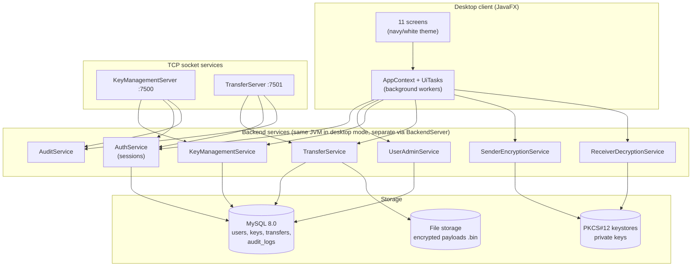
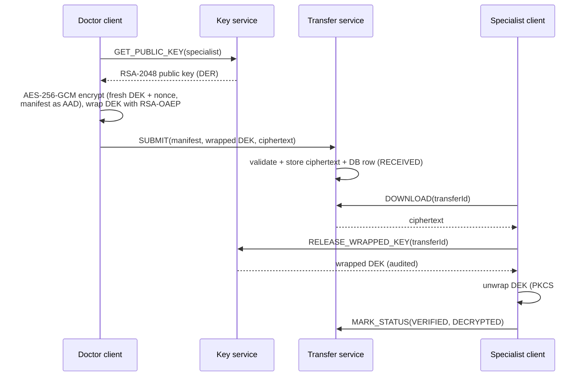

# Architecture

## 1. Component overview



The UI never performs cryptographic or permission logic itself; it calls the
**service layer**, which is the same code the socket servers invoke. Every
`AuthorizationService.require*` check therefore runs server-side regardless of
whether the caller is local UI or a remote socket client.

## 2. Package map

| Package | Responsibility |
|---|---|
| `config` | `AppConfig`: env/properties resolution, `describe()` with redacted secrets |
| `util` | `Validation` (username/filename/size), `Hashing` (SHA-256 hex), `SecureIds` (SecureRandom tokens), `SampleImageGenerator` |
| `model` | `User`, `Role`, `ImageTransfer`, `TransferStatus`, `TransferManifest`, `AuditEvent`, `UserSession`, `ProtectedKeyMaterial`, `PublicKeyRecord` |
| `crypto` | `CryptoEngine` (AES-GCM), `KeyProtector` (RSA-OAEP wrap/unwrap), `KeystoreService` (PKCS#12), `SelfSignedCertificate`, `PasswordHasher`, payload records |
| `security` | `PathGuard` (traversal defence), `SessionManager`, `AuthorizationService`, exceptions |
| `dao` | `Database` (connections + transactions), `SchemaInitializer`, `Jdbc{User,Transfer,KeyRecord,AuditLog,PublicKey}DAO`, `DaoFactory` |
| `service` | Business logic: auth, user admin, key management, storage, transfer state machine, sender/receiver crypto flows, audit |
| `network` | Wire `Protocol` + `MessageIO` framing, `KeyManagementServer`, `TransferServer`, `ProtocolClient`, `KeyServiceClient`, `TransferClient`, `BackendServer` |
| `demo` | `HeadlessEndToEndDemo` acceptance harness |
| `ui` | JavaFX `MainApp`, `AppContext`, `UiTasks`, 11 controllers |

## 3. Wire protocol

Versioned framed protocol over TCP (see `network/Protocol`, `MessageIO`):

```
Request  : MAGIC(u16) VERSION(u8) TYPE(u8) | fields/payload | framed per message
Response : STATUS(u8) | body
```

* Max frame 32 MiB; every read is bounded (`readBoundedPayload`).
* Status codes: `OK=0, ERROR=1, AUTH_REQUIRED=2, DENIED=3, NOT_FOUND=4, BAD_REQUEST=5`.
* Key-management ops: `PING LOGIN LOGOUT GET_PUBLIC_KEY RELEASE_WRAPPED_KEY LIST_USERS
  CREATE_USER SET_USER_ACTIVE LIST_AUDIT LIST_RECIPIENTS`.
* Transfer ops: `SUBMIT LIST_INCOMING LIST_OUTGOING DOWNLOAD REJECT MARK_STATUS
  GET_TRANSFER LIST_ALL`.
* `RELEASE_WRAPPED_KEY` returns the **wrapped** DEK only, only to the addressed
  recipient, and writes a `KEY_RELEASE` (or `KEY_RELEASE_DENIED`) audit event.

## 4. Transfer data model



State machine (enforced in `TransferStatus.canTransitionTo`, applied by
`JdbcTransferDAO.updateStatus`):

```
PENDING → ENCRYPTING → SENDING → RECEIVED → VERIFIED → DECRYPTED
   │           │           │         │
   └───────────┴───────────┴─────────┴──→ FAILED   (and RECEIVED → REJECTED)
FAILED / REJECTED are terminal.
```

An interrupted submission (socket cut mid-transfer) never reaches `RECEIVED`; the demo
and unit tests assert this explicitly.

## 5. Database schema (summary)

| Table | Purpose | Notable columns |
|---|---|---|
| `users` | accounts | `password_hash` (PBKDF2 string), `role`, `is_active` |
| `public_keys` | per-user key versions | `public_key_der` (never private), `key_version`, `keystore_ref` |
| `key_records` | wrapped DEK registry | `wrapped_key`, `wrap_algorithm`, `recipient_key_id` |
| `transfers` | transfer metadata + manifest fields | `nonce`, `plaintext_sha256`, `storage_ref`, `status` |
| `audit_logs` | append-only events | `event_type`, `outcome`, `detail`, `source_ip`, `created_at` |

Full DDL: [`../sql/schema.sql`](../sql/schema.sql).

## 6. Concurrency model

* Socket servers: thread-per-connection (`new Thread` per accept), daemon threads,
  bounded read timeouts.
* UI: all blocking work on JavaFX `Task` workers (`UiTasks.run`) — the FX thread never
  performs I/O.
* Database: short autocommit transactions via `Database.inTransaction` with rollback on
  error.

## 7. Error handling principles

* Fail closed: malformed frames, size overruns, path escapes and unauthorized access
  produce explicit error statuses and audit events, never silent success.
* Crypto failures surface as `TamperedException` with an honest message
  ("the ciphertext was modified, corrupted or the key is incorrect") — the UI shows
  errors instead of fake success notifications.
