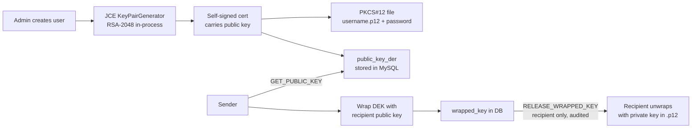

# Security Design

## 1. Assets and threat model

| Asset | Where it lives | Threat |
|---|---|---|
| Medical image plaintext | Recipient disk (after decrypt) | Unauthorized disclosure |
| AES DEK (per transfer) | RAM during encrypt/decrypt; wrapped in DB | Key theft |
| Recipient private keys | Local PKCS#12 keystores | Key theft, offline brute force |
| Passwords | Never stored; PBKDF2 hashes in DB | Offline cracking |
| Wrapped DEKs + ciphertext | MySQL + file storage | DB leak, tampering |
| Audit trail | `audit_logs` table | Repudiation, tampering |

**In scope (demonstrated):** a curious other-user on the same system, a passive DB
reader, ciphertext tampering in transit/at rest, replay of status updates, path
traversal on storage references, role confusion via the API.

**Out of scope (explicit):** a malicious DBA rewriting audit rows, physical theft with
live memory capture, side-channel attacks on JCE providers, compromised endpoint
malware, traffic analysis without TLS.

## 2. Cryptographic design

| Concern | Choice | Rationale |
|---|---|---|
| Image encryption | AES-256-GCM, 12-byte unique nonce, 128-bit tag | AEAD: confidentiality + integrity in one standard primitive (NIST SP 800-38D) |
| Per-transfer key | Fresh 256-bit DEK from `SecureRandom` | Compromise of one transfer does not affect others |
| Key wrapping | RSA-2048, `RSA/ECB/OAEPWithSHA-256AndMGF1Padding` | Standard JCE transformation; OAEP resists chosen-ciphertext padding attacks |
| Manifest binding | Manifest fields = GCM AAD | Metadata (who→whom, sizes, SHA-256) is authenticated; swapping manifests breaks decryption |
| Integrity check | GCM tag + independent SHA-256 of plaintext | Tag verifies before release; SHA-256 is compared with the manifest after decryption |
| Password hashing | PBKDF2-HMAC-SHA512, 120 000 iterations, 16-byte per-user salt, `$pbkdf2-sha512$` modular format | JCE-only, iterative; salt defeats rainbow tables |
| Session tokens | 256-bit `SecureRandom` values, 8 h TTL | Unpredictable; expired sessions pruned |
| Nonce policy | Fresh 96-bit nonce per encryption, never reused | GCM security depends on uniqueness |

No custom cryptographic primitives are implemented; all algorithms come from the JDK
provider (SunJCE) or are constructed from standard primitives.

## 3. Key lifecycle

* **Private keys never leave the keystore**: no protocol message, DB column or log line
  carries private key material. `KeystoreService.loadPrivateKey` is the only accessor.
* **DB leak safety:** a stolen database yields only public keys and RSA-wrapped DEKs;
  unwrapping requires the private key from the keystore files.
* **Rotation:** `UserAdminService`/keystore re-provisioning can create new key versions
  (`key_version` increments); old wrapped keys stay tied to the key version that
  wrapped them.

## 4. Access control (server-side)

`AuthorizationService` is invoked inside every service method — UI visibility rules are
cosmetic only.

| Rule | Enforcement |
|---|---|
| Only DOCTOR (and ADMIN) may submit transfers | `requireCanSend` in `prepareOutgoing`/`receiveIncoming` |
| Only SPECIALIST (and ADMIN) may receive/decrypt | `requireCanReceive`, `requireDecryptPermission` |
| Only the addressed recipient may download payload / get wrapped key | `requireKeyReleasePermission`, `requireRecipientOrAdmin` checks on `recipient_id` |
| Only ADMIN manages users / views audit | `requireAdmin` in `UserAdminService`, `AuditService` endpoints |
| Claimed sender identity must equal the authenticated session | `requireSenderIdentity` (prevents spoofing `sender_user_id` in submissions) |
| Inactive accounts cannot authenticate | `requireActive` + login rejection |
| Status updates follow the state machine | `TransferStatus.canTransitionTo` + `JdbcTransferDAO.updateStatus` |
| Storage references cannot escape the storage root | `PathGuard.resolveInside`/`requireInside` (null bytes, traversal, absolute paths rejected) |
| Frame/size limits | `MessageIO` 32 MiB cap, `AppConfig.maxFileBytes` upload cap |

Every denial writes an audit event (`AUTH_FAIL`, `KEY_RELEASE_DENIED`, `ACCESS_DENIED`).

## 5. Audit logging

Append-only at the application layer. Events: `AUTH_OK`, `AUTH_FAIL`, `USER_CREATED`,
`USER_DISABLED`, `USER_ENABLED`, `KEY_REGISTERED`, `KEY_RELEASE`, `KEY_RELEASE_DENIED`,
`ENCRYPT_OK`, `TRANSFER_RECV`, `TRANSFER_SENT`, `INTEGRITY_OK`, `DECRYPT_OK`,
`TRANSFER_FAILED`, `TRANSFER_REJECTED`, `ACCESS_DENIED`. Each row carries user,
transfer id, outcome, detail and source IP. The demo asserts presence of the key
events including denied-access entries.

## 6. What this project does NOT guarantee

* TLS is **off by default** for the localhost demo; without TLS a network attacker can
  observe metadata and ciphertext in transit (they still cannot decrypt).
* No forward secrecy; no key escrow; no HSM.
* PKCS#12 files are protected by a password; a weak keystore password is brute-forceable
  offline (the demo default is documented and must be changed for shared machines).
* The self-signed certificates are keystore requirements, **not** a trust framework —
  nothing validates certificate chains.
* Audit rows live in the same database; an administrator with raw SQL access can alter
  them. External log shipping/WORM is out of scope.
* PBKDF2 at 120k iterations is a reasonable 2024 baseline for an academic project but
  is not a substitute for a memory-hard KDF in a high-value deployment.
* The application does not scan images for malware, does not anonymise DICOM headers,
  and does not implement consent management.

## 7. Secure-coding practices applied

* No plaintext keys/passwords in logs; `AppConfig.describe()` redacts secrets.
* Validation of usernames, filenames, sizes before any crypto or I/O.
* Bounded reads on all socket inputs; `SecureRandom` for all tokens/keys/nonces.
* Prepared statements everywhere (no string-built SQL).
* Cleanup: demo wipes its data directory on start; key material is zeroed where
  practical (`Arrays.fill` on temporary byte arrays).
